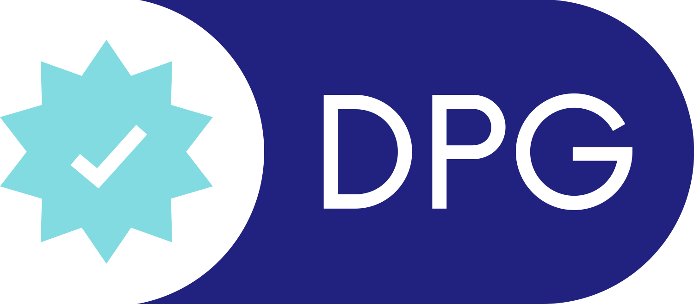
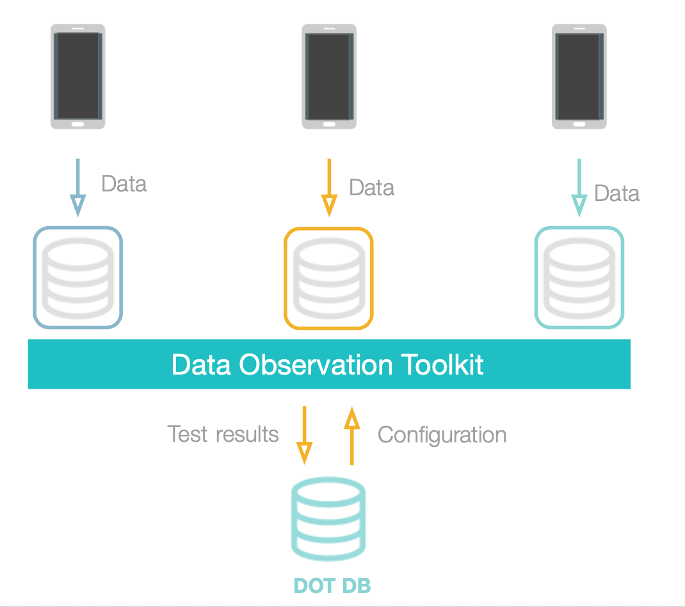

<div align="center">




</div>

> Verified as a **Digital Public Good** by the Digital Public Goods Alliance.

# The Data Observation Toolkit (DOT)

The Data Observation Toolkit (DOT) monitors data to flag problems with data integrity and scenarios that might need attention. Typical tests include checks for missing/duplicate and inconsistent data, outliers, and domain-specific signals.

DOT includes a simple user interface for configuring the powerful dbt and Great Expectations libraries, as well as a database for storing and classifying data monitoring results. The ultimate aim of DOT is to provide easier access to data monitoring without the need for deep technical skills.



## Background

In 2019, the United Nations Statistical Commission stated: *"Every misclassified or unrecorded death is a lost opportunity to ensure other mothers and babies do not die in the same way. When it comes to health, better data can be a matter of life and death."*

DataKind developed DOT in response to a demand for a tool to increase trust in public health data — data which underpins the ability of a health system to provide equitable, data-driven, optimized health service delivery and improve policy response. DOT was developed with globally distributed frontline health partners, expertise from Ministries of Health, frontline health workers, and funders.

Read more:
- [Pathways to Increasing Trust in Public Health Data](https://chance.amstat.org/2021/09/pathways/)
- [Empowering Health Worker and Community Health Systems](https://www.datakind.org/blog/empowering-health-workers-and-community-health-systems)
- [Harnessing the power of data science in healthcare](https://anchor.fm/medxtekafrica/episodes/Ep19---Harnessing-the-power-of-data-science-in-healthcare-e1iijkm)
- [How Data Empowers Health Workers—and Powers Health Systems](https://chwi.jnj.com/news-insights/how-data-empowers-health-workers-and-powers-health-systems)

## Sample Data

You are free to use [these rich datasets](https://drive.google.com/drive/folders/12tyTqYNNNpDZxQKMQqv7FVOCq18LCurQ?usp=sharing) ranging from global COVID-19 patients to United States childhood obesity records, as well as a synthetic dataset showcasing DOT's capabilities on frontline health data.

## Conceptual Overview Demo

Watch the brief video below for a quick, high-level walkthrough of DOT in action. It demonstrates the core concepts like projects, entities, and running a quick test in the UI.

> ⚠️ **Important:** This video is strictly a conceptual overview. For actual deployment and configuration, please follow our [Documentation Directory](#documentation-directory) below.

🎥 **[Watch: DOT Conceptual Overview Demo](./videos/dot_overview_demo.mp4)**

## Quick Start

The fastest way to get started using DOT is to use the Docker environment and the provided demo data.

### Prerequisites

1. Install [Docker Desktop](https://www.docker.com/products/docker-desktop/). We recommend using at least 4GB memory (set in Docker preferences).
2. If running on a Mac M1/M2 chip, install Rosetta and set `export DOCKER_DEFAULT_PLATFORM=linux/amd64` in your terminal.
3. Install Python 3.8.9 or later.
4. Install the necessary Python packages:
   ```bash
   pip install gdown
   pip install python-on-whales
   ```

### Running the DOT Quick-Start Demo

1. Start Docker on your machine.
2. Open a Terminal and navigate into the `docker` sub-folder:
   ```bash
   cd <PATH_TO_DOT>/Data-Observation-Toolkit/docker/
   ```
3. Run the demo script:
   - Mac/Linux: `python3 run_demo.py`
   - Windows: `python3 .\run_demo.py`
4. The script will automatically start the DOT backend, launch the Appsmith User Interface, and open it in your browser. Wait until the terminal says **"Press return to stop DOT container"** — this indicates the demo is fully launched.
5. Once you are done with the demo, press return in your Terminal to gracefully stop the containers.

## Documentation Directory

If you want to move beyond the Quick Start, please refer to our detailed documentation files below:

- 🚀 **[Deployment Guide](./docs/deployment.md)**: Instructions for manual Docker builds, Airflow orchestration, EC2 setup, and manual Appsmith setup.
- ⚙️ **[Configuration Guide](./docs/configuration.md)**: Instructions for adding entities and configuring tests (via the UI or Raw SQL).
- 🏃 **[Execution Guide](./docs/execution.md)**: Instructions on how to manually trigger pipelines or execute Airflow DAGs.
- 🏗️ **[Architecture & Troubleshooting](./docs/architecture_and_troubleshooting.md)**: Deep dive into dbt/Great Expectations internals, the full DB schema, Superset visualization, port troubleshooting, and useful database queries.
