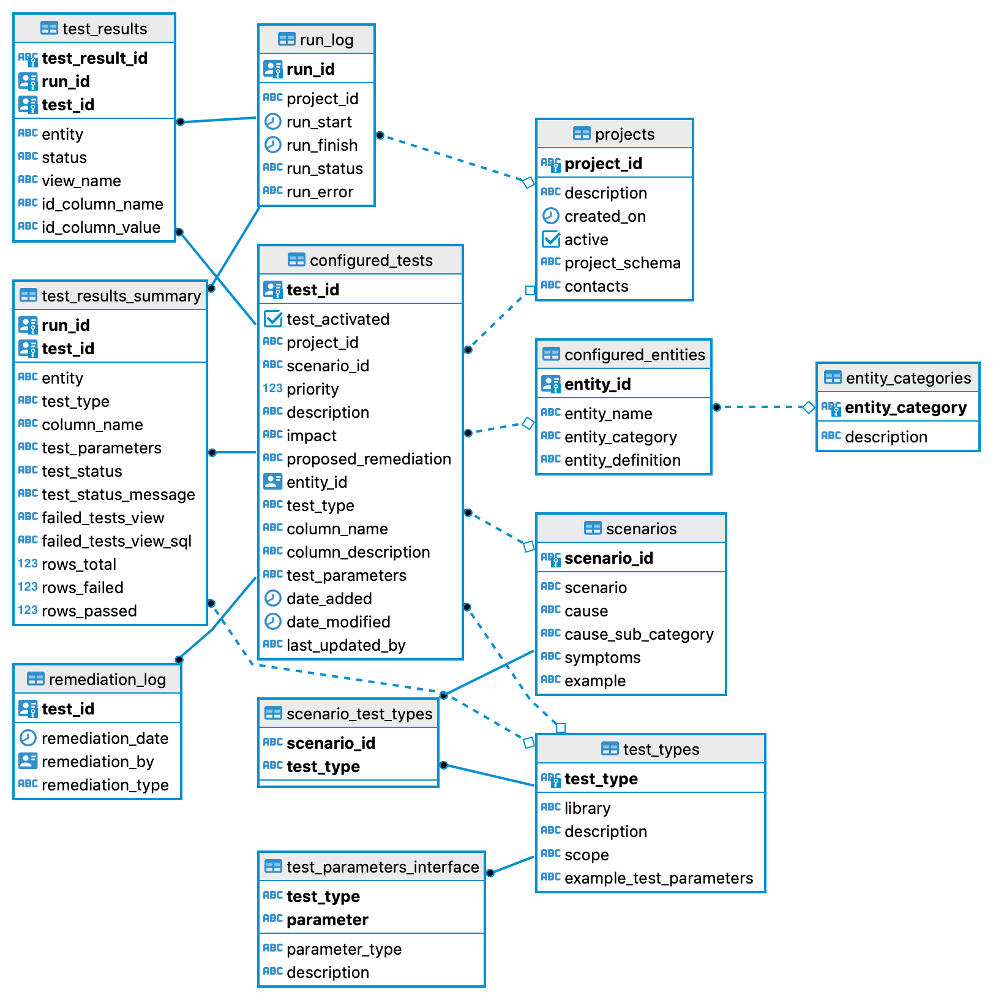

# Architecture & Troubleshooting

This document provides a deep dive into the internal architecture of DOT (dbt and Great Expectations) and offers troubleshooting advice for common issues, including useful database queries.

## Table of Contents
- [Internal Architecture Overview](#internal-architecture-overview)
  - [Database Connection Registry (`dot_config.yml`)](#database-connection-registry-dot_configyml)
  - [dbt Integration](#dbt-integration)
  - [Great Expectations Integration](#great-expectations-integration)
  - [Database Schema](#database-schema)
- [How to Visualize Results Using Superset](#how-to-visualize-results-using-superset)
- [How DOT Works](#how-dot-works)
- [Troubleshooting Port Conflicts](#troubleshooting-port-conflicts)
- [Useful Database Queries](#useful-database-queries)

---

## Internal Architecture Overview

DOT uses [dbt](https://docs.getdbt.com/) and [Great Expectations](https://greatexpectations.io/) to execute tests. Most tests leverage dbt (for SQL-based tests like `not_null` or custom SQL), while Great Expectations is reserved for statistical checks via Python/Pandas.

### Database Connection Registry (`dot_config.yml`)

The `dot_config.yml` file is the connection registry that allows DOT to authenticate and run tests against the correct databases. When deployed via Docker, this file is mounted to the container at `/app/dot/config/dot_config.yml`.

It defines these blocks:
- **`dot`**: Global configuration. `output_schema_suffix: tests` is the suffix DOT appends for test-output schemas (e.g., `public_tests`).
- **`dot_db`**: The internal DOT database where the application state, configuration metadata, and test results are stored.
- **`[ProjectName]_db`**: A connection block for that project's data. In the Airflow demo, `ScanProject1_db` and `EduProject_db` share one Postgres server but differ by schema (`data_dot_data_public` and `data_dot_data_education`).

**Example Structure:**
```yaml
dot:
  output_schema_suffix: tests
dot_db:
  type: postgres
  host: dot_db
  user: postgres
  pass: "{{ env_var('POSTGRES_PASSWORD') }}"
  port: 5432
  dbname: dot_db
  schema: dot
  threads: 4
ScanProject1_db:
  type: postgres
  ...
  schema: data_dot_data_public
EduProject_db:
  ...
```

Notice the use of `{{ env_var('POSTGRES_PASSWORD') }}`. This Jinja templating securely reads the password from your environment variables at runtime rather than storing it in plain text.

**The Lookup Process:**
Before a run starts, two things must be true: the YAML key must be the project id plus `_db` (project `ScanProject1` requires a block named `ScanProject1_db`), and that block's `schema` must be the schema Airflow loaded for that project. When you trigger a run for `ScanProject1`, the DOT engine reads `ScanProject1_db` and builds the dbt and Great Expectations connections from it.

*Note on Schema Naming: Airflow names the destination schema `data_<source_connid>_<source_schema>`, using the Airflow source connection id from `dot_projects.json`. In the demo, the connection id is `dot_data`, so `public` becomes `data_dot_data_public` and `education` becomes `data_dot_data_education`. If the connection id were `postgres` and the source schema were `public`, the schema would be `data_postgres_public`. If you are running a non-Airflow deployment, or connecting to an existing external database, you must set `schema` to the real target schema instead of an Airflow-generated name.*

(For more on isolation, see the [Technical Documentation](../TECHNICAL_DOCUMENTATION.md)).

### dbt Integration

Most dbt files are **dynamically written** by DOT based on the `dot.configured_entities` and `dot.configured_tests` tables.

- **`macros/`**: Jinja macros to support organized code and custom schema tests.
- **`models/`**: Contains dynamically generated SQL for models and `.yml` files for schema tests.
- **`tests/`**: Custom SQL tests dynamically generated for `custom_sql` test types.
- **`target/` (Auto-generated)**: Compiled SQL used to create models and tests.
- **`dot/utils/dbt.py`**: The core Python utility that manages dbt job execution, extracts failing rows into views, and updates test results to the DB.

### Great Expectations Integration

- **`expectations/`**: JSON files indicating the tests to be run (Dynamically generated).
- **`plugins/custom_expectations.py`**: Where arbitrary Python checks are implemented under the `CustomSqlAlchemyDataset` class.
- **`batch_config.json`**: Defines datasources and test suites. A default empty dataset is added here for custom expectations as a placeholder.

### Database Schema

The DOT database schema is defined as follows:



| Table | Description |
| :--- | :--- |
| `projects` | Defines the projects DOT can be run for. Typically a project maps to a single source database. |
| `configured_entities` | Holds entities: the views onto underlying data that DOT will test. |
| `entity_categories` | Category of each entity (e.g., "Pre-natal care"). Useful for segmenting results. |
| `configured_tests` | Defines what tests to run for each project. |
| `scenarios` | The DOT Taxonomy scenario for each test. |
| `test_types` | Available test types (e.g., `not_null`, `unique`, `custom_sql`). |
| `scenario_test_types` | The test types that apply for any given scenario. |
| `test_parameters_interface` | JSON object defining interface parameters required for each test type. |
| `run_log` | Log of DOT runs, with stop/start times and failure messages. |
| `test_results` | Main test results table, indicating test failures at the row level. |
| `test_results_summary` | Aggregated test results for each run. |
| `remediation_log` | Record of remediation actions (not yet implemented). |

The `test_results` table includes fields to link back to the data tested. A useful Postgres function retrieves a JSON record for the data tested — see [Viewing Raw Data for Failed Tests](#2-viewing-raw-data-for-failed-tests) below.

---

## How to Visualize Results Using Superset

At time of writing, Superset setup is not fully automated. Once your Docker containers are running for the first time, run these initialization commands:

```bash
docker exec -it superset superset fab create-admin \
  --username admin \
  --firstname Superset \
  --lastname Admin \
  --email admin@superset.com \
  --password admin

docker exec -it superset superset db upgrade
docker exec -it superset superset init
```

You can ignore any warnings about `CACHE_TYPE` being null. Once complete, open Superset at [http://localhost:8080/login/](http://localhost:8080/login/) and log in with **admin / admin**.

> **Note:** Google Chrome is recommended over Safari.

### Connect to the DOT Database

1. In Superset, select **Data > Databases** from the top menu.
2. Click the **+ Database** button on the right.
3. Choose **PostgreSQL** and enter these parameters:
   - **Host**: `dot_db`
   - **Database**: `dot_db`
   - **Display name**: `dot_db`
   - **Port**: `5432`
   - **User**: `postgres`
   - **Password**: `<Your POSTGRES_PASSWORD>`

### Create Datasets and Charts

1. Select **Data > Datasets** and click **+ DATASET**.
2. Select the table(s) you want from the DOT database (e.g., `test_results`).
3. Once a dataset exists, you can [create charts and dashboards](https://superset.apache.org/docs/creating-charts-dashboards/first-dashboard#adding-a-new-table).

> ⚠️ **Important:** If using Superset with Docker, be sure to **export your dashboard** before rebuilding your Docker environment — you will lose it otherwise.

---

## How DOT Works

The Data Observation Toolkit uses [dbt](https://docs.getdbt.com/docs/introduction/) and [Great Expectations](https://greatexpectations.io/) as its test execution framework.

Most tests are built on **dbt**, leveraging its support for base tests (not null, foreign key checks, accepted values, etc.) expressible as YAML entries, plus custom SQL tests using Jinja. **Great Expectations** adds Python-based checks for anything that cannot be expressed in SQL — for example, tests that inspect the statistical distribution of data.


## Troubleshooting Port Conflicts

DOT relies on several ports. If Docker Compose fails to bind a port, ensure they are free:

- **Port 82**: Appsmith (DOT UI)
- **Port 5432/5433**: PostgreSQL (Internal DOT DB)
- **Port 8083**: Apache Airflow UI
- **Port 8080**: Apache Superset

**Resolution**: If a port is in use (e.g., local Postgres on 5432), modify the left-side (host) port in `docker-compose.yml` (e.g., `5433:5432`).

---

## Useful Database Queries

Connect to `dot_db` using `psql` or DBeaver to run these queries for advanced insights.

### 1. Statistics on Failed Tests

Get a simple count of failures grouped by test type:

```sql
SELECT
   tr.run_id,
   ct.test_type,
   COUNT(*)
FROM
   dot.test_results tr
JOIN 
   dot.configured_tests ct ON tr.test_id = ct.test_id
GROUP BY
   tr.run_id,
   ct.test_type
ORDER BY
   ct.test_type;
```

### 2. Viewing Raw Data for Failed Tests

The `dot.test_results` column `view_name` provides the DB view holding the failed data. You can query the underlying data for each failed test using this built-in function:

```sql
SELECT 
   tr.test_id,
   tr.status,
   dot.get_test_result_data_record(
       ce.entity_name, 
       tr.id_column_name, 
       tr.id_column_value,
       'public_tests'
   )
FROM
   dot.scenarios s
JOIN dot.configured_tests ct ON s.scenario_id = ct.scenario_id
JOIN dot.configured_entities ce ON ce.entity_id = ct.entity_id
JOIN dot.test_results tr ON tr.test_id = ct.test_id
LIMIT 10;
```
*(Change `'public_tests'` to your actual source schema if using Airflow).*
